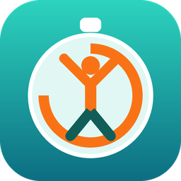
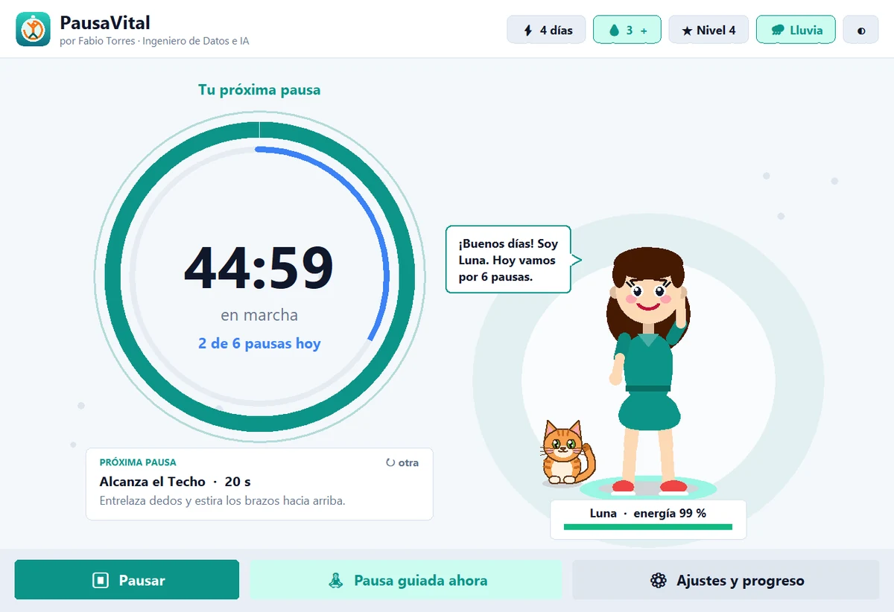
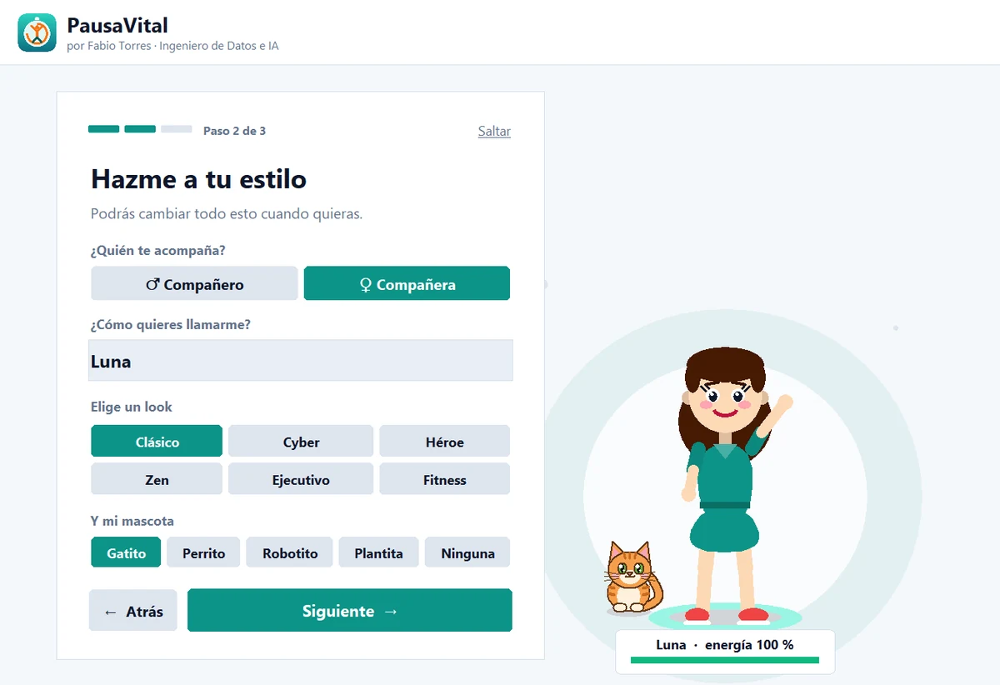
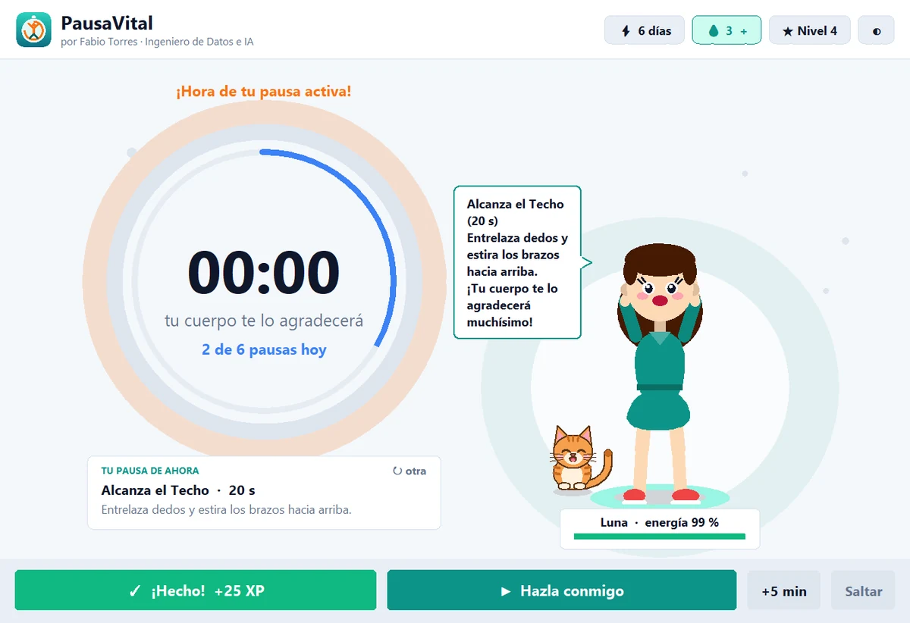
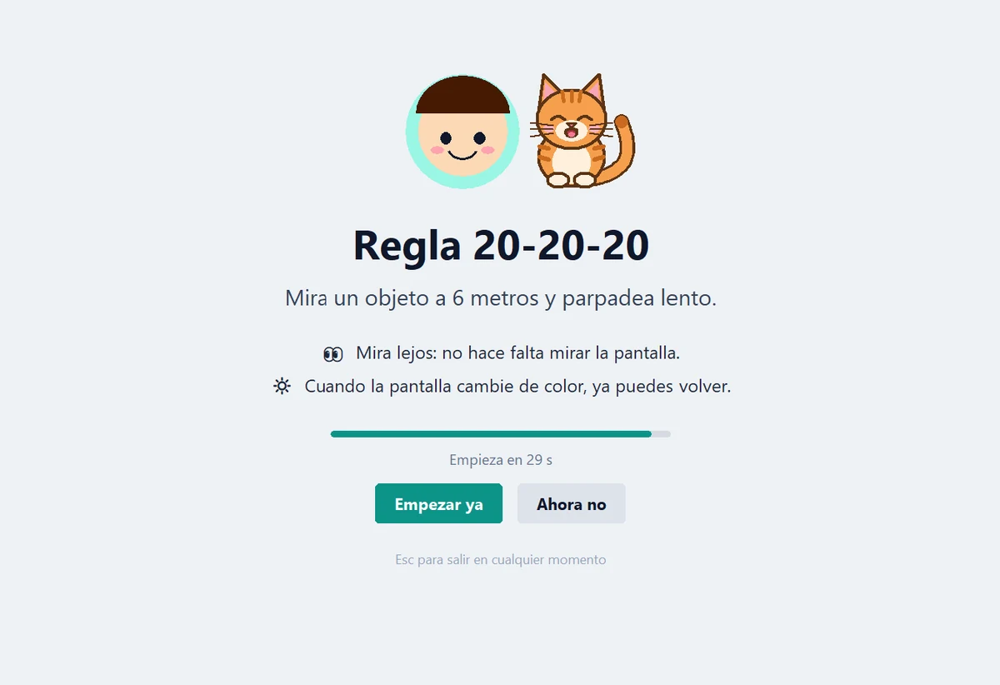
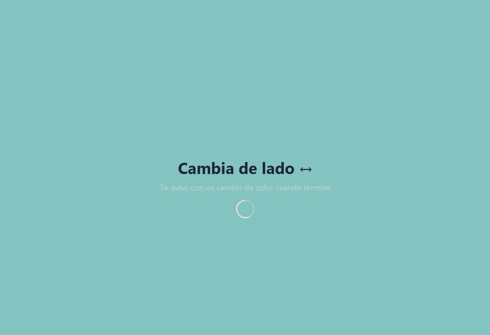
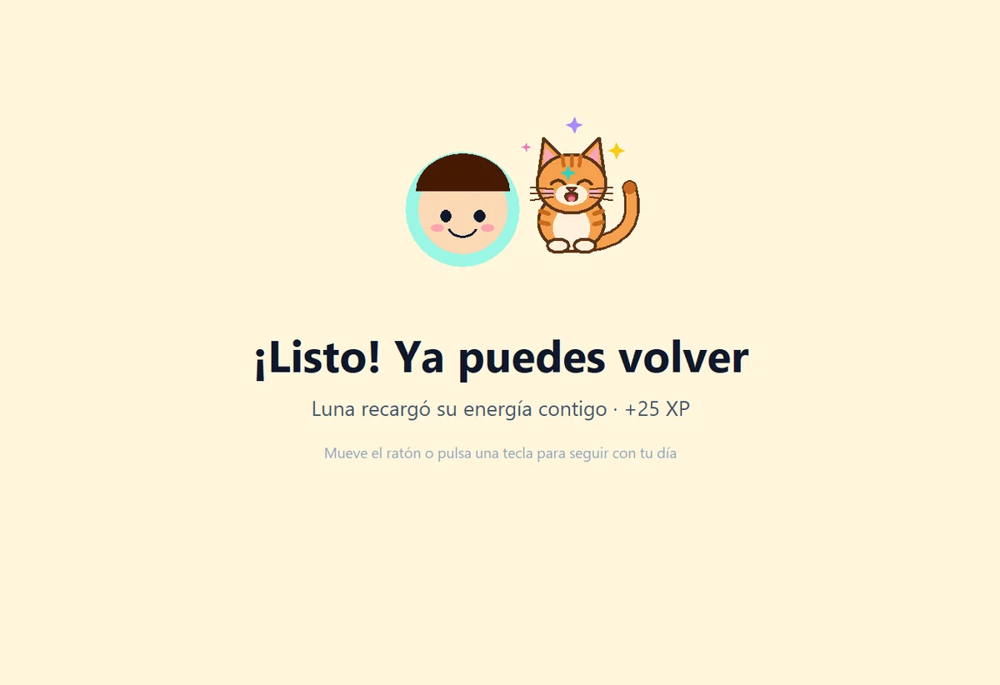
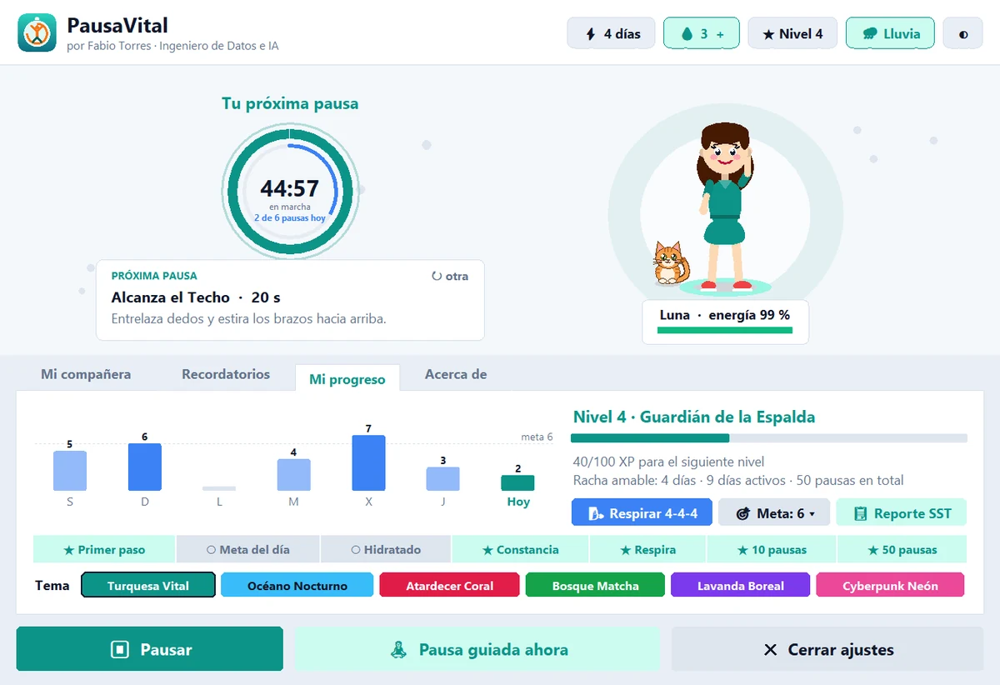
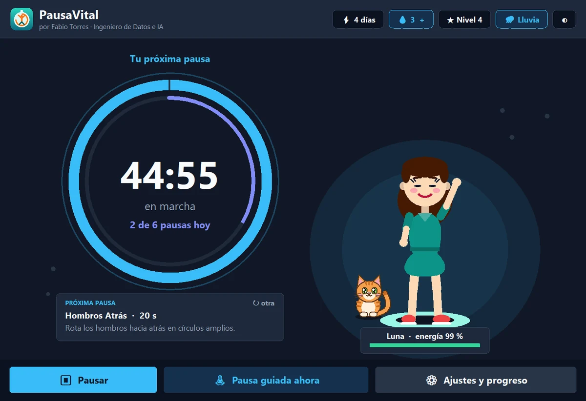

<p align="center">
  
</p>

<h1 align="center">PausaVital</h1>

<p align="center">
  <strong>Pausas activas y bienestar diario</strong><br />
  Un compañero o compañera animada que te recuerda moverte, estirarte, descansar la vista e hidratarte mientras trabajas, y hace las pausas contigo.
</p>

<p align="center">
  <a href="https://neurodeveloper11.github.io/PausaVital/"><strong>🌐 Sitio oficial</strong></a> ·
  <a href="https://neurodeveloper11.github.io/PausaVital/descargas/Instalar_PausaVital.exe"><strong>⬇️ Descargar para Windows</strong></a> ·
  <a href="https://github.com/neurodeveloper11/PausaVital/releases/latest">📦 Releases</a> ·
  <a href="LICENSE">⚖️ Licencia</a>
</p>

<p align="center">
  Creado por <a href="https://www.linkedin.com/in/fabio-torres-39364b258/"><strong>Fabio Torres</strong></a> · Ingeniero de Datos e IA
</p>

<p align="center">
  
</p>

---

## ¿Qué es PausaVital?

PausaVital es un programa **gratuito para Windows 10 y 11**. Cada cierto tiempo (30, 45 o 60 minutos, tú eliges) tu compañero virtual te invita a hacer una **pausa activa de 15 a 30 segundos**: un estiramiento de cuello, la regla 20-20-20 para tus ojos, una respiración 4-4-4… Te la explica en una frase y luego **te deja despegarte de la pantalla**: la pantalla queda en calma y cambia de color cuando terminas.

- ✅ Sin anuncios, sin cuentas y sin internet.
- ✅ Tus datos se guardan solo en tu computador.
- ✅ No necesitas instalar Python ni nada adicional.

## ⬇️ Instalación (1 minuto, sin conocimientos técnicos)

1. Descarga **[Instalar_PausaVital.exe](https://neurodeveloper11.github.io/PausaVital/descargas/Instalar_PausaVital.exe)** (8,9 MB).
2. Ábrelo con doble clic. Si Windows muestra **«Windows protegió su PC»**, pulsa **Más información → Ejecutar de todas formas**. Ese aviso aparece con los programas nuevos y gratuitos que no pagan una firma comercial. Si quieres, verifica la huella SHA-256 que aparece en el sitio oficial.
3. Pulsa **Instalar PausaVital**. Se crea el ícono en el Escritorio y en el menú Inicio, y el programa se abre con su bienvenida.

Para desinstalarlo: **Configuración de Windows › Aplicaciones › PausaVital › Desinstalar**.

¿Sin permisos para instalar programas? Usa la **[versión portable (.zip)](https://neurodeveloper11.github.io/PausaVital/descargas/PausaVital_Portable.zip)**: descomprímela y abre `PausaVital.exe`.

<details>
<summary>Para equipos de TI: instalación desatendida</summary>

```
Instalar_PausaVital.exe /silencioso                 instala con las opciones recomendadas
Instalar_PausaVital.exe /silencioso /sin-inicio     sin abrirse al encender el PC
Instalar_PausaVital.exe /silencioso /abrir          y abre PausaVital al terminar
"Desinstalar PausaVital.exe" /desinstalar /silencioso
```
Opciones adicionales: `/sin-escritorio`, `/sin-menu`. Se instala por usuario en `%LOCALAPPDATA%\Programs\PausaVital`, sin permisos de administrador.
</details>

## ✨ Cómo funciona

| 1. Elige quién te acompaña | 2. Trabaja con calma | 3. Despégate de la pantalla |
| :---: | :---: | :---: |
|  |  |  |
| 3 pasos: compañero o compañera, nombre, look, mascota y frecuencia. | Te avisa 30 s antes; si te levantaste por tu cuenta, lo nota y no te interrumpe. | Te explica el ejercicio, deja la pantalla en calma y al terminar celebra tu progreso. |

### 👀 Una pausa de verdad, lejos de la pantalla

Descansar la vista mientras lees instrucciones en la pantalla no tiene sentido. Por eso, durante la pausa no hay nada que leer: PausaVital te guía con **señales de color**, que se perciben con el rabillo del ojo, y funcionan aunque trabajes **con el sonido apagado**. Tú eliges la pantalla de pausa: **clara** (blanco grisáceo, la predeterminada) u **oscura**.

| 1. Te lo explica en una frase | 2. La pantalla queda en calma | 3. El color te avisa que terminaste |
| :---: | :---: | :---: |
|  |  |  |
| Unos segundos para leer el ejercicio y saber cuál será la señal. Puedes empezar ya o dejarlo para después. | Mira lejos, estírate o cierra los ojos. Un destello indica cambiar de lado; en la respiración, un círculo de color crece al inhalar y baja al exhalar. | La pantalla pulsa dos veces en color (o se ilumina, en la pantalla oscura) y queda en un tono cálido. Si el sonido está activo, suena además una campanita. Al tocar el ratón, vuelves a tu trabajo. |

Si mueves el ratón antes de tiempo, no hay regaños: tu compañero te recuerda la señal y te ofrece terminar o salir. `Esc` cierra la pausa en cualquier momento. En *Ajustes › Recordatorios* eliges **Pantalla de pausa: Clara u Oscura**, o desactivas **Pausa guiada sin mirar la pantalla** para volver a la guía clásica dentro de la ventana.

## 🧠 Diseño basado en ciencia del comportamiento

PausaVital se diseñó a partir de lo que hace queridas y efectivas a las mejores apps de bienestar (Finch, Stretchly, LookAway) y de la evidencia sobre hábitos:

- **Compañero que se beneficia cuando te cuidas, nunca te castiga.** Inspirado en el «self-care pet» de Finch: su energía sube con tus pausas y tu agua; nunca se enferma ni se pone triste por ti.
- **Micro-pausas que sí se hacen.** Un meta-análisis encontró que las pausas de 10 minutos o menos aumentan la vitalidad y reducen la fatiga ([Albulescu et al., 2022](https://doi.org/10.1371/journal.pone.0272460)). Las de PausaVital duran 15-30 segundos y son guiadas.
- **Rachas amables.** Saltarse un día no frena la formación de un hábito ([Lally et al., 2010](https://doi.org/10.1002/ejsp.674)), así que los fines de semana no rompen la racha y saltarse una pausa no tiene castigo, para evitar el efecto «ya lo arruiné, mejor lo dejo».
- **Celebración inmediata.** Confeti, sonido suave y energía al 100% justo después de cada pausa (refuerzo positivo), más niveles, medallas y una gráfica semanal.
- **Respeto por la concentración.** Aviso 30 s antes, posponer 5 min, saltar sin culpa, silenciar 1 hora, horario laboral, y **detección de descansos naturales**: si no usas ratón ni teclado durante 5 minutos, el reloj se reinicia solo. Si no respondes a un aviso, se aparta y vuelve más tarde.
- **Cuida tu vista.** Incluye la regla 20-20-20 recomendada por la [American Academy of Ophthalmology](https://www.aao.org/eye-health/tips-prevention/computer-usage). Como esa regla pide mirar lejos, durante la pausa la pantalla queda en calma y avisa con un cambio de color, al estilo de herramientas como Stretchly y LookAway, en lugar de pedirte que sigas leyendo.

> PausaVital promueve hábitos saludables; no es un dispositivo médico ni sustituye la orientación de un profesional de la salud.

## 🎨 Funciones

- **Compañero o compañera**: tú eliges quién te acompaña. 12 looks (6 en cada versión), 9 peinados, 7 estilos de ropa (incluye vestido y falda), 7 accesorios, colores libres y 4 mascotas animadas.
- **Mascotas con vida propia**: gatito, perrito, robotito o plantita, cada uno con su propio dibujo. Pasean, juegan, bostezan y se duermen si te alejas del PC. Se alegran cuando las acaricias con un clic, beben contigo cuando registras agua y celebran tus logros. En el aviso de pausa se asoman por la tarjeta con su propio globo de diálogo.
- **Visitas sorpresa** (opcional): de vez en cuando, tu mascota aparece unos segundos en la esquina de la pantalla para saludarte o recordarte tomar agua. Aparece como máximo 3 veces al día, nunca en silencio, fuera de tu horario ni en pantalla completa. Se desactiva en Ajustes.
- **20 ejercicios guiados** de vista, cuello, espalda, muñecas, piernas y respiración, filtrables por tipo. Se guían a pantalla completa con señales de color (y campanita opcional), en pantalla clara u oscura, para que no tengas que mirar la pantalla; en varios monitores, los cubre todos.
- **Modo reunión** *(nuevo en 1.1)*: si tu micrófono o tu cámara están en uso (Teams, Meet, Zoom, WhatsApp) o Windows está en modo presentación, la pausa queda en espera y aparece 15 segundos después de que cuelgas. Si solo hay una ventana a pantalla completa (un video, un escritorio remoto), espera como máximo 20 minutos. Lo consulta en tu propio equipo, sin escuchar ni grabar nada. Se desactiva en *Ajustes › Recordatorios*.
- **Agua y meta diaria**: un clic por cada vaso (en la cabecera, en el aviso o desde el ícono junto al reloj). Si llevas 3 horas de trabajo sin registrar agua, tu próxima pausa te invita a tomar un vaso y lo registras con un botón o con la tecla `A`.
- **Sonido para concentrarte** *(nuevo en 1.1)*: lluvia suave, olas en calma o cuenco tibetano de fondo, a volumen bajo y en un canal aparte, así que los avisos no lo cortan. Se calla solo durante las llamadas. Para usar tus propios audios, guarda `lluvia`, `olas` o `zen` (`.mp3` o `.wav`) en `%APPDATA%\PausaVital\ambiente`.
- **Registro para SG-SST** *(nuevo en 1.1)*: desde *Mi progreso › Reporte SST* generas una hoja de 1 página, lista para imprimir o guardar en PDF, con tus pausas, días con pausas, vasos de agua, la gráfica de los últimos 14 días y las pausas por zona del cuerpo. Es un autorregistro para entregar como evidencia de participación, no un certificado médico.
- **Progreso**: gráfica de la semana, niveles, 7 medallas y racha amable.
- **5 tonos para los avisos**: Motivador, Anticamarón, Sargento Fit, Maestro Zen y Reina del Drama.
- **6 temas** claros y oscuros, y sonidos tipo campana suaves (sintetizados, sin archivos externos).
- **Trabaja en segundo plano**: al cerrar la ventana, PausaVital se queda como un ícono junto al reloj de Windows (sin ocupar la barra de tareas) y te avisa cuando toca. Clic en el ícono para abrirlo; clic derecho para pausa guiada, registrar agua, cambiar sonido ambiental, silenciar o salir. Puede abrirse solo al encender el PC.
- **Nítido en cualquier pantalla**: compatible con escalado 125 %, 150 % y 200 %.
- Si usabas **Pausas Activas Pro**, tu personaje y tu progreso se migran solos.

<p align="center">
  
  &nbsp;
  
</p>

## ⚖️ Licencia: gratis para usar, el código con permiso

PausaVital es **freeware**: puedes descargarlo e instalarlo **gratis**, en tu casa, en tu universidad o en todos los equipos de tu empresa, sin pedir permiso.

El **código fuente es privado** y **todos los derechos están reservados**. Para obtener el código, modificar el programa, redistribuirlo en otro sitio o incluirlo en otro producto o servicio, escribe a **psicologofabiotorres@gmail.com** con el asunto *«Solicitud de uso de PausaVital»* contando quién eres y qué necesitas.

Si hablas de PausaVital o lo recomiendas, usa este crédito:

> **PausaVital — Creado por Fabio Torres, Ingeniero de Datos e IA**

Términos completos en [LICENSE](LICENSE).

## 👤 Autor

**Fabio Torres**, Ingeniero de Datos e IA y Desarrollador Full-Stack. Diseña software y sistemas de datos donde la ingeniería se une a la ciencia del comportamiento humano.

[LinkedIn](https://www.linkedin.com/in/fabio-torres-39364b258/) · [GitHub](https://github.com/neurodeveloper11) · psicologofabiotorres@gmail.com
